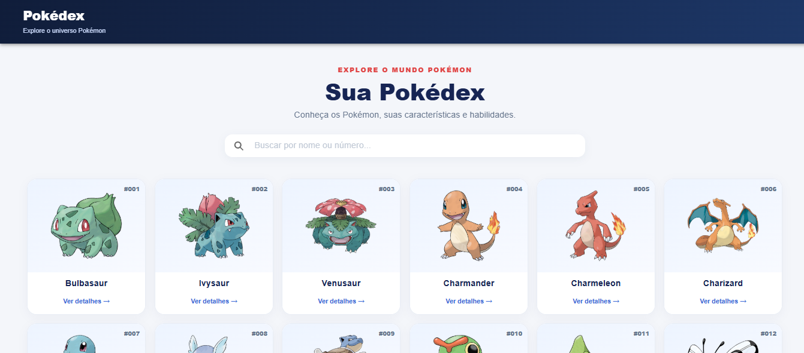
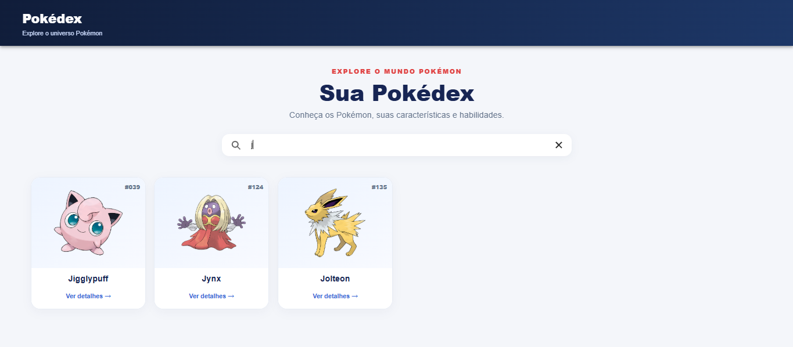

# PokéAPI 
Aplicação web desenvolvida com **Ionic** e **Angular** para explorar Pokémon, pesquisar por nome e consultar informações individuais. Os dados são obtidos dinamicamente por meio da [PokéAPI](https://pokeapi.co/).

<p align="left">
  
  
  
  
  
</p>

## Funcionalidades

- **Listagem de Pokémon:** consulta e exibição dos Pokémon disponibilizados pela API.
- **Pesquisa por nome:** filtragem dos resultados com base no texto digitado.
- **Página de detalhes:** visualização de informações específicas do Pokémon selecionado.
- **Imagens dos Pokémon:** exibição das imagens disponibilizadas pela PokéAPI.
- **Interface responsiva:** layout desenvolvido com componentes Ionic e estilos SCSS.

## Capturas de tela

### Página inicial

Visualização da lista de Pokémon e do campo de pesquisa.

<p align="center">
  
</p>

### Pesquisa de Pokémon

Exemplo de pesquisa utilizando a letra `j`.

<p align="center">
  
</p>

## Tecnologias utilizadas

| Tecnologia | Aplicação no projeto |
|---|---|
| Angular | Componentes, organização da aplicação e rotas |
| Ionic Framework | Componentes de interface e estrutura visual |
| TypeScript | Implementação da lógica e tipagem |
| SCSS | Estilização das páginas e componentes |
| RxJS | Gerenciamento de operações assíncronas |
| PokéAPI | Fornecimento dos dados dos Pokémon |

# Como executar o projeto

## Pré-requisitos

- Node.js
- npm
- Ionic CLI

Instale o Ionic CLI, caso ainda não esteja instalado:

```bash
npm install -g @ionic/cli
```

## Instalação

Clone o repositório:

```bash
git clone https://github.com/nanda-marques/Pokemon_API.git
```

Entre na pasta do projeto:

```bash
cd Pokemon_API
```

Instale as dependências:

```bash
npm install
```

Inicie a aplicação:

```bash
ionic serve
```

A aplicação será disponibilizada localmente pelo servidor de desenvolvimento do Ionic.

## Integração com a PokéAPI

O projeto utiliza a PokéAPI para consultar os dados dos Pokémon.

Endpoint principal:

```
https://pokeapi.co/api/v2/pokemon
```

É necessária uma conexão com a internet para carregar os dados fornecidos pela API.


## Possíveis adições

- Implementar filtros por tipo de Pokémon.
- Adicionar paginação ou carregamento progressivo.
- Melhorar os estados de carregamento e tratamento de erros.